<picture>
  <source media="(prefers-color-scheme: dark)" srcset="https://raw.githubusercontent.com/michaelnkr808/michaelnkr808/main/assets/banner-dark.svg">
  
</picture>

CS student at UC Santa Cruz, graduating December 2027. I do computer vision research and build full-stack and ML projects.

**Looking for SWE and ML/CV internships for summer 2027.**

  
  
  

  <picture>
    <source media="(prefers-color-scheme: dark)" srcset="https://raw.githubusercontent.com/michaelnkr808/michaelnkr808/stats/commits-dark.svg">
    
  </picture>

## Research

Computer vision lab at UCSC, January 2026 to present. I'm exploring world models built on frozen vision encoders, and how to tell which encoders, alone or combined, work best for robot manipulation. Before this I worked on 3D Gaussian Splatting and SAM2 with Meta Aria glasses footage.

## Roles

- ACM Research Lab co-lead and Instruction Officer at UCSC, October 2026 to present
- CSE 13S group tutor, September 2026 to present
- Software developer at UCSC Blueprint, December 2025 to June 2026, building an app for a nonprofit client

## Projects

**[AGNI-Network](https://github.com/beong789/AGNI-Network)**: Wildfire risk map for California built from NASA FIRMS, NWS, and US Drought Monitor data, with a LangGraph chat agent for questions. I was the main contributor on a team of five. Python, FastAPI, LangChain, LangGraph, Gemini, Docker.

**[Visage](https://github.com/michaelnkr808/visage)**: Face-recognition memory assistant for MentraOS smart glasses. It remembers who you've met and what you talked about. InsightFace for face embeddings, Gemini for pulling names and context from conversations, FastAPI, PostgreSQL/pgvector, Bun and the MentraOS SDK.

## Awards

- 3rd place, UN Reboot the Earth 2025 (AGNI-Network)
- Best Hardware Hack, CruzHacks 2026 (HardwareHub)

## Stack

<picture>
  <source media="(prefers-color-scheme: dark)" srcset="https://raw.githubusercontent.com/michaelnkr808/michaelnkr808/main/assets/stack-dark.svg">
  
</picture>

Plus pgvector for embedding search.
